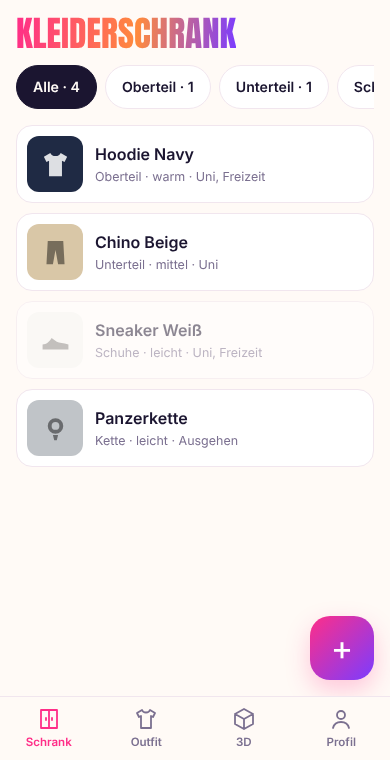
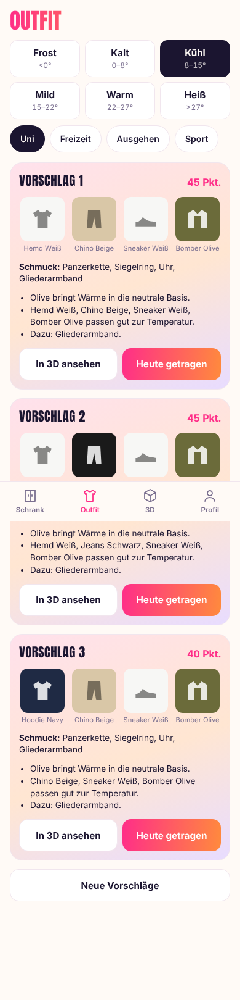
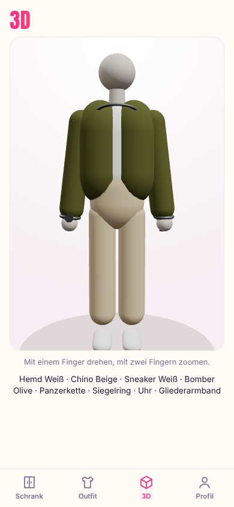
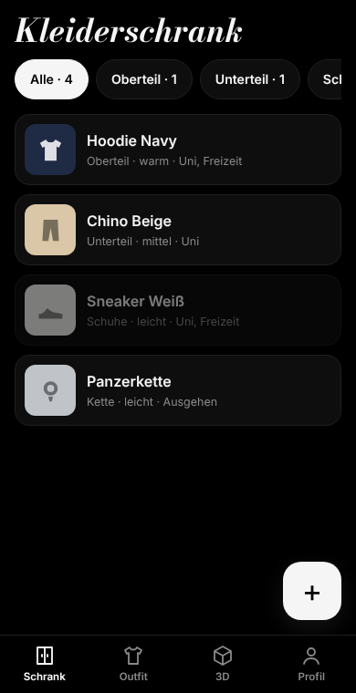
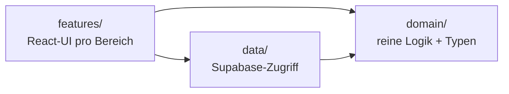

# Outfit – persönliche Kleiderschrank- und Outfit-App

Eine mobile-first Web-App (PWA) für meinen eigenen Kleiderschrank: Teile mit Foto erfassen, mit einem Tap als „da“ oder „weg“
markieren und regelbasierte Outfit-Vorschläge mit Begründung bekommen – inklusive Schmuck und einer einfachen 3D-Vorschau.
Entstanden als Lern- und Portfolio-Projekt im 1. Semester Medieninformatik (HTWK Leipzig).

**Live:** https://clothing-app-seven-mauve.vercel.app (Login nur für mich)

| Kleiderschrank | Outfit-Vorschläge | 3D-Vorschau | Dunkler Modus |
|---|---|---|---|
|  |  |  |  |

<sub>Screenshots mit Beispieldaten.</sub>

## Funktionen

- **Kleiderschrank:** Teile anlegen, bearbeiten, archivieren – mit Kategorie, Farben aus einer festen Palette, Wärmegrad, Anlässen
  und optionalem Foto (Kamera oder Galerie, vor dem Upload im Browser auf max. 1200 px verkleinert)
- **Verfügbarkeit:** „da / weg“ mit einem Tap, sofort sichtbar (optimistisches Update mit Rücksprung bei Fehlern)
- **Outfit-Generator:** Temperatur (6 Stufen) und Anlass wählen → 3 Vorschläge mit Punkten und Begründung, „Neue Vorschläge“ blättert weiter
- **Schmuck:** Standard-Set („Trage ich meistens“) plus gelegentlicher Wechsel; beim Sport nur die Uhr
- **Getragen & Verlauf:** Outfit als „heute getragen“ speichern, Verlauf mit „Nochmal tragen“, Archiv zum Wiederherstellen
- **3D-Ansicht:** stilisierte Figur in den Farben des Outfits, drehen und zoomen per Touch
- **PWA:** auf dem Homescreen installierbar, startet auch offline mit den zuletzt geladenen Daten
- **Zwei Looks:** heller Modus mit Sonnenuntergangs-Verläufen, dunkler Modus in Schwarz-Weiß

## Technik

React 19 · TypeScript · Vite · React Router · TanStack Query · Supabase (Postgres, Auth, Storage) ·
three.js mit React Three Fiber · vite-plugin-pwa · Vitest · Vercel

## Architektur

Drei Schichten, Abhängigkeiten zeigen nur in eine Richtung:



| Ordner | Aufgabe |
|---|---|
| `src/domain/` | Typen, Farbpalette, Outfit-Generator. **Kein** React, **kein** Supabase, kein `Date.now()`/`Math.random()` – Datum und Zufall werden übergeben. Dadurch vollständig testbar. |
| `src/data/` | Einzige Stelle, die mit Supabase spricht (Repositories + Mapping DB-Zeile ↔ Domain-Typ) |
| `src/features/` | UI: `wardrobe`, `outfit`, `viewer3d`, `profile`, `auth` |
| `src/ui/` | Gemeinsame Bausteine und Design-Tokens (alle Farben als CSS-Variablen) |
| `supabase/migrations/` | Datenbank-Schema inkl. Row Level Security und privatem Foto-Bucket |

### So entsteht ein Outfit-Vorschlag

1. **Harte Filter** (`domain/outfit/filters.ts`): verfügbar, nicht archiviert, passender Anlass, passender Wärmegrad
2. **Kandidaten** (`generate.ts`): alle Kombinationen Oberteil × Unterteil × Schuhe (× Jacke je nach Temperatur)
3. **Ausschluss:** exakt gleiche Kombination aus den letzten 3 Tagen
4. **Bewertung** (`rules/`): jede Regel liefert Punkte + Begründungssatz – Farbharmonie, Wärmegrad, „kürzlich getragen“
5. **Schmuck** (`accessories.ts`): Standard-Set + 0–2 Wechsel, bevorzugt lange nicht Getragenes
6. **Sortieren und seitenweise anzeigen**

Alle Stellschrauben (Punkte, Temperaturgrenzen, Zeitfenster, Schmuck-Obergrenzen) stehen in `src/domain/outfit/config.ts`.

### Wo spätere Erweiterungen andocken

| Später | Andockstelle |
|---|---|
| KI-Erkennung aus Fotos | Supabase Edge Function bekommt `photo_path`, liefert Feldvorschläge; API-Schlüssel nur dort |
| Bewertungen / Lernen | Spalte `rating` in `outfits` + neue Regel in `domain/outfit/rules/` |
| Wetter-API | setzt nur das Temperatur-Band; Generator bleibt unverändert |
| Realistische 3D-Modelle (GLB) | Einträge in `viewer3d/garments/registry.ts` austauschen |
| Neue Kategorien / Kriterien | Typ + Check-Constraint erweitern, neue Regel-Datei |

## Lokal starten

```bash
npm install
cp .env.example .env.local   # Supabase-URL und Publishable/anon-Key eintragen
npm run dev                  # Entwicklungsserver auf http://localhost:5173
```

```bash
npm test                     # Tests der Outfit-Logik (Vitest)
npm run build                # Produktions-Build inkl. Service Worker
```

**Supabase einrichten:** neues Projekt → SQL Editor → Inhalt von `supabase/migrations/0001_init.sql` ausführen →
unter Authentication die Registrierung abschalten und den eigenen Nutzer anlegen.

**Deployment:** Vercel importiert das GitHub-Repo, erkennt Vite automatisch; die beiden `VITE_SUPABASE_*`-Variablen
in den Projekteinstellungen eintragen. Jeder Push auf `main` wird automatisch ausgerollt.

## Sicherheit

- Jede Tabelle hat Row Level Security: Zeilen gehören genau einem Nutzer (`user_id = auth.uid()`)
- Fotos liegen in einem privaten Bucket und werden nur über zeitlich begrenzte, signierte Links angezeigt
- Im Frontend steht nur der öffentliche Publishable/anon-Key, nie der `service_role`-Key

## Git-Spickzettel

```bash
# Repo einmalig auf den Mac holen
git clone https://github.com/Nailuj3034/Clothing-App.git

# Neuesten Stand holen (im Projektordner)
git pull

# Was hat sich lokal geändert?
git status

# Eigene Änderungen speichern und hochladen
git add .
git commit -m "kurze Beschreibung"
git push

# Letzte Commits ansehen
git log --oneline -10
```

## Projekt-Dokumente

- Design: [`docs/superpowers/specs/2026-11-16-outfit-app-design.md`](docs/superpowers/specs/2026-11-16-outfit-app-design.md)
- Umsetzungsplan: [`docs/superpowers/plans/2026-11-16-outfit-app-v1.md`](docs/superpowers/plans/2026-11-16-outfit-app-v1.md)
